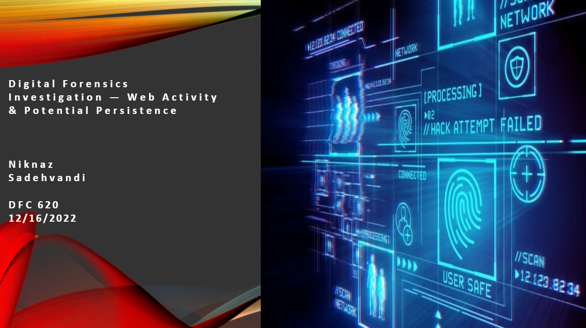

# Digital Forensic Investigation — Web Activity & Potential Persistence

## Overview

A digital forensic investigation of a simulated Windows environment examining suspicious IIS web activity, potential persistence configurations, and possible sensitive-data exposure.

The project evaluates available forensic artifacts, distinguishes observed evidence from suspected activity, and identifies evidence gaps requiring further investigation.

## Why This Project Matters

- Demonstrates IIS web-server log analysis and Windows artifact examination.
- Investigates potential persistence through Startup-folder entries and scheduled tasks.
- Examines possible exposure of sensitive material.
- Applies evidence-based reasoning to assess suspected intrusion activity.
- Identifies limitations and recommends additional forensic validation.

## Investigation Environment

- **Operating System:** Windows
- **Web Server:** Microsoft IIS 10.0
- **Evidence Sources:** IIS logs, Windows Startup folder, Autoruns entries, scheduled-task XML, and file-system screenshots
- **Tools:** Sysinternals Autoruns, Notepad++, Windows File Explorer
- **Reference Frameworks:** NIST digital forensics guidance and MITRE ATT&CK

## Investigation Process

1. Examined IIS logs for unusual HTTP request patterns and directory enumeration indicators.
2. Reviewed requests to `/hidden/` paths and analyzed HTTP response status codes.
3. Inspected the Administrator's Startup folder and relevant Autoruns entries.
4. Reviewed the `PROJECT2` scheduled-task XML configuration.
5. Examined apparent sensitive information and related web-server artifacts.
6. Compared available timestamps and identified gaps in the forensic evidence.

## Key Findings

- **IIS Activity:** Multiple requests to `/hidden/` paths were consistent with possible web-directory enumeration. HTTP 200 responses were recorded for `/hidden/index.htm`.
- **Startup Artifact:** An enabled Autoruns entry referenced `chinco.bat`, a potentially suspicious logon-persistence configuration.
- **Scheduled Task:** The displayed `PROJECT2` XML included an enabled daily calendar trigger, although its actions and execution history were not established.
- **Sensitive Material:** A screenshot displayed password-like information and an apparent RSA private-key block. The available records did not establish unauthorized disclosure or exfiltration.
- **File-System Evidence:** Screenshots identified an HTML document under the IIS web root and the location of Windows scheduled-task definitions.

## Overall Assessment

The available evidence supports suspected reconnaissance and potentially suspicious persistence configurations.

However, the screenshots alone are insufficient to confirm unauthorized access, successful persistence execution, system compromise, or data exfiltration.

## Recommended Next Steps

- Preserve and review original IIS logs and relevant server configuration.
- Obtain the complete registered scheduled-task XML and execution history.
- Examine available Windows event logs, Sysmon records, or EDR telemetry for process execution.
- Correlate network activity with file-system evidence and relevant timestamps.
- Verify whether the sensitive-looking material was genuine, accessible, or transmitted.

## Project Files

**[View the Digital Forensic Investigation Presentation](Niknaz_Sadehvandi_Digital_Forensic_Investigation.pdf)**

The presentation includes forensic screenshots, technical observations, interpretation, evidence limitations, and recommended investigative steps.

## Evidence Handling

Public evidence images should have potentially sensitive credentials and private-key material permanently redacted. Original evidence should be preserved separately with restricted access.

## Skills Demonstrated

- Digital Forensics and Incident Response (DFIR)
- IIS Web Server Log Analysis
- Windows Startup Artifact Investigation
- Scheduled-Task Analysis
- Potential Persistence Identification
- Forensic Evidence Correlation
- Analytical Reporting and Evidence Limitations

---

**Author:** Niknaz Sadehvandi  
Cybersecurity | Digital Forensics | Security Analysis

[LinkedIn](https://www.linkedin.com/in/Nikki-Sadvand-a34179325) | [GitHub](https://github.com/Nikki-65)
